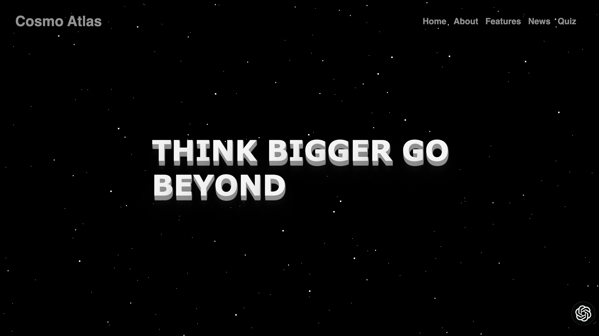
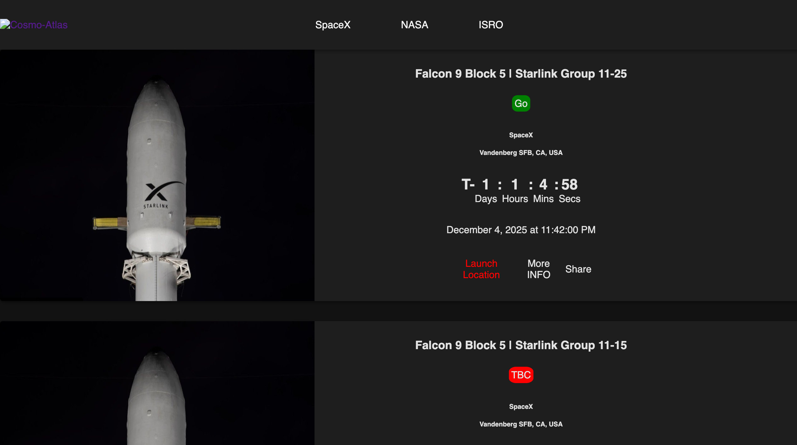
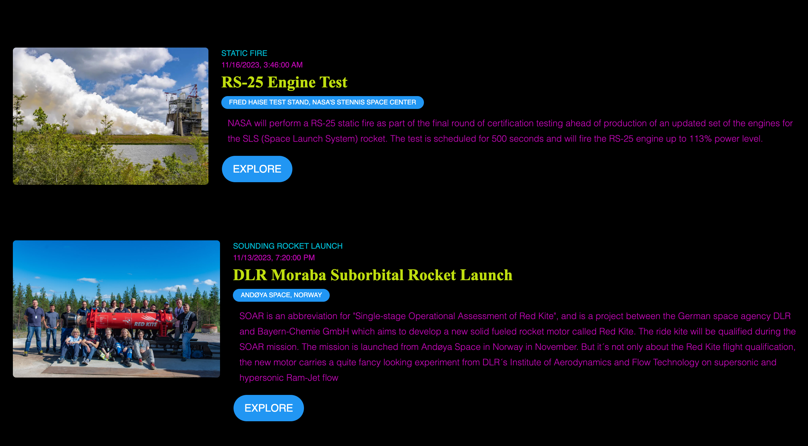

# Cosmo-Atlas

Cosmo-Atlas is a frontend web project that aggregates multiple space-related experiences into a single interface focused on space exploration and missions.

# Dashboard Preview



# Launches Preview



# Events Preview



## Features

- **Landing page**
  - Animated hero section with starfield background.
  - Navigation to News, Events, Launches, and Quiz.
  - Team / "Our Team" section.

- **News** (`/news/index.html`)
  - Space-related news feed powered by the News API.
  - Category shortcuts (SPACE, NASA, ISRO).
  - Search box to query custom topics.

- **Launches** (`/LaunchesAPI/index.html`)
  - Upcoming launch list using the Launch Library 2 API.
  - Cards with image, agency, launch site, countdown timer, and links.

- **Events** (`/events/events.html`)
  - Past space events feed from the Launch Library 2 events endpoint.
  - Cards showing event type, date, location, and description.

- **Quiz** (`/QuizApp/index.html` and `/QuizApp/game.html`)
  - Multiple-choice quiz about space exploration, ISRO, NASA, etc.
  - Score tracking and high scores stored in `localStorage`.

- **Chat widget** (on the landing page)
  - Floating chat icon opening a simple chatbot panel.

## Project structure (high level)

```text
Cosmo-Atlas/
  index.html            # Main landing page
  assets/               # Shared images (logos, backgrounds, icons)
  css/                  # Global and feature styles (main, chat, launches, events)
  js/                   # Global and feature scripts (animation, chat, launches, events)
  news/                 # News page (HTML, CSS, JS)
  LaunchesAPI/          # Launches page HTML (CSS/JS live in css/js)
  events/               # Events page HTML (CSS/JS live in css/js)
  QuizApp/              # Quiz HTML/CSS/JS and related assets
  README.md             # Project documentation
```

## Getting started

- Clone or download this repository.
- Open `index.html` directly in a modern browser, or serve the folder using a simple static server (e.g. VS Code Live Server, `python -m http.server`, etc.).
- Use the navbar on the landing page to navigate to News, Launches, Events, and Quiz.

No build tools are required; this is a pure HTML/CSS/JS project.

## Configuration & API keys

Some parts of the project rely on external APIs that require keys:

- **News** (`news/news.js`)
  - Uses `https://newsapi.org/v2/everything`.
  - Expects a `config.js` file at the project root defining `config.newsAPI_KEY`.
  - `config.js` is listed in `.gitignore` so it is not committed.

- **Chat widget and Quiz**
  - Currently call the OpenAI Chat Completions API from frontend JavaScript.
  - For a production deployment you should move these calls behind a backend or proxy so that API keys are **never exposed in client-side code**.

## External APIs & libraries

- **News API** – `https://newsapi.org/v2/everything`
- **Launch Library 2** – `https://ll.thespacedevs.com/2.2.0/launch/...` and `.../event/...` for launches and events
- **OpenAI Chat Completions API** – used by the chat widget and quiz question generation
- **GSAP & ScrollTrigger** – page animations on the landing page
- **SplitType** – for animating text characters

## Status

This repository currently contains only the frontend portion of the project and is intended to be run as a static site.

**Last updated:** Jan 2024
